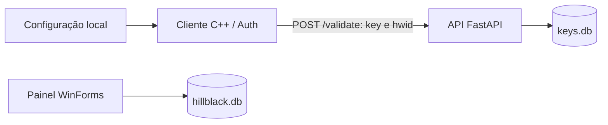

# Autenticação no código recebido

## Componentes e fluxo

Os bancos têm nomes diferentes no código e não há integração de sincronização fornecida.

1. [`WinMain`](../cs2_external/src/main.cpp) carrega `configs/default.hbc` e chama `Auth::validate_online(cfg.saved_key)`. Se a resposta não for `OK`, mostra um erro e termina. `show_login` não é chamado e contém um TODO para a interface de entrada de chave.
2. [`Auth`](../cs2_external/src/auth.cpp) constrói um HWID usando serial de volume, dados CPUID e parte do endereço MAC. Envia chave e HWID em JSON por WinHTTP para o host fornecido no anexo e o caminho `/validate`.
3. [`validate`](../api_server/main.py) consulta a chave no SQLite, verifica revogação e expiração, vincula um HWID ainda vazio ou compara o vínculo existente. Retorna `valid`, além de motivo de falha ou data de expiração e mensagem.
4. O cliente interpreta a resposta em `AuthInfo`. Uma thread de `main.cpp` aguarda cinco minutos entre revalidações e sinaliza encerramento quando `revalidate` retorna falso.

## Credenciais e tokens

- A credencial do cliente é a chave de licença. Não há JWT, OAuth, cookie de sessão, access token ou refresh token: a mesma chave é reenviada na revalidação.
- [`Config::save/load`](../cs2_external/src/config.cpp) inclui `saved_key` no JSON e aplica XOR com uma chave fixa de [`string_enc.hpp`](../cs2_external/src/string_enc.hpp). Isso é ofuscação reversível, não proteção criptográfica de credenciais.
- [`Database.cs`](../admin_panel/Database.cs) cria um administrador inicial com senha fixa no código, armazena o hash BCrypt e usa `BCrypt.Verify` no login. Gera chaves com `Guid.NewGuid()` e as armazena em texto no banco.
- A API registra IP e prefixos da chave/HWID no log. Há uma tabela `auth_log` e um método `log_auth`, mas a rota não chama esse método.

## Limites da implementação recebida

O cliente configura WinHTTP para ignorar erros de certificado; concatena JSON sem escape; usa um extrator de campos simplificado e não verifica explicitamente o status HTTP. `revalidate` procura literalmente `"valid":true`, dependendo da formatação da resposta.

A API aceita uma data de expiração malformada ao capturar `ValueError` sem rejeitar a requisição. A consulta e o vínculo inicial do HWID são operações separadas. Estes pontos foram documentados a partir do código, sem alterações de comportamento nesta organização.
